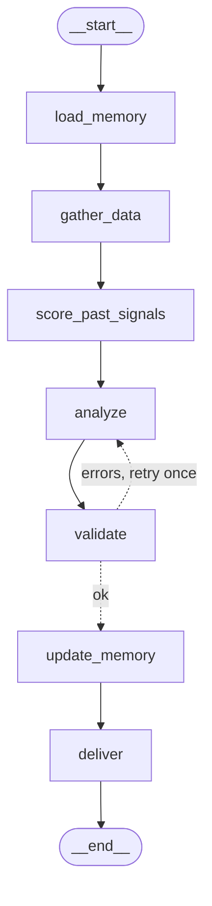

# 🤖 Stock Alert Telegram Bot (GitHub Actions — 100% Free)

AI-powered stock alerts delivered to your Telegram and Discord, running entirely on GitHub Actions for **$0/month** (except ~$1 for Claude API). v6 adds **memory across runs** built with LangChain + LangGraph.

## How It Works

```
GitHub Actions (cron: daily Mon-Fri after the US close)
    │
    ├── Finnhub API → stock prices + news (free)
    │
    ├── LangGraph + Claude → analysis with memory of past calls (~$1/mo)
    │
    ├── memory/ → signal track record + digests, committed back each run
    │
    ├── Telegram Bot → sends alert to your chat (free)
    │
    └── Discord Webhook → sends alert to your server (free, optional)
```

No servers. No hosting. No sign-ups beyond what you already have.

---

## Setup (10 minutes)

### Step 1: Get your API keys (5 min)

| What | Where | Cost |
|------|-------|------|
| Finnhub API key | [finnhub.io/register](https://finnhub.io/register) | Free |
| Anthropic API key | [console.anthropic.com](https://console.anthropic.com) | ~$1/mo |
| Telegram Bot token | Message [@BotFather](https://t.me/BotFather) → send `/newbot` | Free |
| Telegram Chat ID | Message [@userinfobot](https://t.me/userinfobot) → send `/start` | Free |
| Discord Webhook URL | Server Settings → Integrations → Webhooks → New Webhook | Free |

⚠️ **Important:** After creating your Telegram bot, open it and send any message (e.g., "hi"). Bots can't message you until you message them first!

### Step 2: Create a GitHub repo (2 min)

1. Go to [github.com/new](https://github.com/new)
2. Name it `stock-alert-bot` (or anything you like)
3. Make it **Private** (your secrets are in settings, but still good practice)
4. Click **Create repository**

### Step 3: Upload the files (2 min)

Upload these files to your repo keeping the folder structure:

```
your-repo/
├── .github/
│   └── workflows/
│       └── stock-alert.yml    ← GitHub Actions workflow
├── stock_alert_bot.py         ← Entry point
├── requirements.txt           ← Pinned dependencies
├── bot/                       ← LangChain + LangGraph package
├── memory/                    ← Persistent memory (committed by the workflow)
├── tests/                     ← Unit tests
└── README.md                  ← This file
```

**Easiest way:** fork or clone this repo, or push it with `git push`. The bot is now a multi-file package, so uploading files one by one through the web UI is error-prone.

### Step 4: Add your secrets (2 min)

1. In your repo, go to **Settings** → **Secrets and variables** → **Actions**
2. Click **"New repository secret"** and add each one:

| Secret Name | Value |
|------------|-------|
| `FINNHUB_API_KEY` | Your Finnhub API key |
| `ANTHROPIC_API_KEY` | Your Anthropic API key (starts with `sk-ant-`) |
| `TELEGRAM_BOT_TOKEN` | Your bot token from BotFather |
| `TELEGRAM_CHAT_ID` | Your numeric chat ID |
| `DISCORD_WEBHOOK_URL` | Your Discord webhook URL (optional) |
| `LANGSMITH_API_KEY` | LangSmith tracing key (optional) |

### Step 5: Test it! (1 min)

1. Go to **Actions** tab in your repo
2. Click **"Stock Alert Bot"** in the left sidebar
3. Click **"Run workflow"** → **"Run workflow"**
4. Wait ~30 seconds
5. Check your Telegram — you should see an alert! 🎉

---

## Schedule

The bot runs automatically once a day, Monday through Friday, after the US market closes:

| Berlin Time | UTC | Alert |
|------------|-----|-------|
| 23:30 (summer) / 22:30 (winter) | 21:30 | Daily close summary |

Running after the close means every quote is a closing price, so signals are opened and scored on the same basis.

*Note: GitHub Actions cron can have delays of 5-15 minutes. This is normal.*

---

## Customizing

### Change your watchlist
Edit `bot/config.py`:
```python
CORE_WATCHLIST = ["AAPL", "MSFT", "NVDA", "GOOGL", "AMZN"]
```

### Change alert schedule
Edit `.github/workflows/stock-alert.yml`:
```yaml
schedule:
  - cron: '30 21 * * 1-5'  # Change this time (UTC); add lines for more runs
```

If you add more cron lines, also set the repository variable `ALERTS_PER_DAY` (Settings → Secrets and variables → Actions → **Variables**) to the number of runs per day. GitHub can't read cron times from a variable, so the schedule itself stays in the YAML; `ALERTS_PER_DAY` makes the bot keep the right amount of digest history (`max(7, 5 × runs)`) and show the right footer. Claude cost scales with the number of runs.

### Add more stocks
Add symbols to `CORE_WATCHLIST` or the `SECTORS` dict in `bot/config.py`. Finnhub supports all major US stocks.

---

## 🧠 Memory & LangChain architecture

v6 remembers what it said. Each run scores its earlier signals against live prices and feeds the track record, recent digests and per-ticker notes back into Claude, so alerts can say things like *"NVDA BUY @ $182 Mon → +3.8% ✅"* or *"defense rally, day 4"*.

The pipeline is a LangGraph `StateGraph`:

```
 START
   │
   ▼
 load_memory ──► gather_data ──► score_past_signals ──► analyze ◄─────────┐
 (JSON files)   (watchlist,      (live price for open    (ChatAnthropic   │ errors and
                 prices, news)    BUY/SELL, close >5d)    structured out) │ retries < 1
                                                              │           │
                                                              ▼           │
                                                          validate ───────┘
                                                              │ ok / out of retries
                                                              ▼
                                                        update_memory ──► deliver ──► END
                                                        (ledger, digest,   (Telegram text +
                                                         ticker store,      Discord embed)
                                                         save JSON)
```

Mermaid, generated with `build_graph().get_graph().draw_mermaid()`:



### Memory files (`memory/`, committed back to `main` by the workflow)

| File | Contents |
|------|----------|
| `signals.json` | Signal ledger: every BUY/SELL/WATCH with entry price, status, reaffirm count, return and win/loss/flat outcome. Same open ticker+action is reaffirmed, not duplicated; a BUY/SELL reversal closes the old call. Signals close after 5 calendar days. |
| `digests.json` | Last 7 alert digests (more if `ALERTS_PER_DAY` > 1) plus up to 8 weekly summaries (older digests are compressed by an LLM chain, with a no-LLM fallback). |
| `tickers.json` | Per-ticker notes (signal history, mention count, last note) held in a LangGraph `InMemoryStore` while running. |

Missing files start empty. Invalid JSON logs a warning and starts empty. Memory never crashes a run.

### Where LangChain / LangGraph features are used

| Feature | Where |
|---------|-------|
| `ChatAnthropic` | `bot/chains.py` `get_llm()` (model `claude-sonnet-4-6`, retries and timeout built in) |
| `ChatPromptTemplate` | `bot/chains.py` analysis, digest and weekly prompts |
| `with_structured_output(MarketAlert)` | `bot/chains.py` analysis chain, Pydantic models in `bot/schemas.py` |
| LCEL `prompt \| llm \| StrOutputParser()` | `bot/chains.py` weekly summary chain |
| `StateGraph`, conditional edges | `bot/graph.py` (validate then retry loop) |
| `InMemoryStore` | `bot/memory.py` per-ticker notes |
| LangSmith tracing | automatic via env vars, see below |

### Validation

Every signal ticker must exist in the fetched quotes and BUY/SELL entry prices must be within 1.5% of the live quote. Failures trigger one retry with the problems fed back to Claude. After that, invalid signals are dropped and mover prices are overwritten with the real quotes. If the Claude call fails completely, a plain fallback message with prices is delivered.

### Dry run

```bash
export FINNHUB_API_KEY=... ANTHROPIC_API_KEY=...
DRY_RUN=1 python stock_alert_bot.py
```

Runs everything including Claude, prints the Telegram text and Discord embed JSON, sends nothing and writes no memory files. No delivery channel is needed in dry-run mode.

### Optional: LangSmith tracing

Add a `LANGSMITH_API_KEY` repository secret. The workflow then sets `LANGSMITH_TRACING=true` and `LANGSMITH_PROJECT=stock-alert-bot`, and every chain and graph node shows up in LangSmith. Locally:

```bash
export LANGSMITH_API_KEY=... LANGSMITH_TRACING=true LANGSMITH_PROJECT=stock-alert-bot
```

### Tests

```bash
pip install -r requirements.txt
python -m unittest discover -s tests -v
```

No network or API key needed.

---

## Costs

| Service | Monthly Cost |
|---------|-------------|
| GitHub Actions | **$0** (uses ~15 of 2,000 free minutes) |
| Finnhub API | **$0** (free tier: 60 calls/min) |
| Telegram Bot | **$0** |
| Claude API (Sonnet) | **~⅓ of the old 3×/day cost** (~22 runs × 2 calls: analysis + digest) |
| **Total** | **Claude API only; scales with `ALERTS_PER_DAY`** |

---

## Troubleshooting

**No Telegram message received?**
- Did you message your bot first? (Send it "hi")
- Check your TELEGRAM_CHAT_ID — it should be numeric
- Go to Actions tab → click the failed run → read the logs

**Workflow not running on schedule?**
- GitHub disables scheduled workflows on inactive repos after 60 days
- Fix: Make any commit (even editing README) to re-activate
- Or manually trigger it from the Actions tab

**No Discord message received?**
- Make sure `DISCORD_WEBHOOK_URL` is set in repository secrets
- Verify the webhook URL is from the correct channel (Server Settings → Integrations → Webhooks)
- Long alerts are automatically split into multiple messages — this is normal

**Claude API error?**
- Check your API key starts with `sk-ant-`
- Verify you have billing set up at console.anthropic.com

---

## Example Alert

```
🤖 Stock Alert Bot
⏰ 2026-03-01 15:00 UTC
────────────────────

📊 Market Overview
🟢 NVDA: $142.50 (+3.2%) | Strong momentum
🟢 AAPL: $238.10 (+0.8%) | Steady gains
🔴 TSLA: $312.40 (-2.1%) | Selling pressure
🟡 MSFT: $445.20 (+0.1%) | Flat, wait for earnings

📰 Key Headlines
• NVIDIA announces new AI chip partnership with major cloud provider
• Fed signals possible rate hold in April meeting

🟢 BUY: NVDA — Positive sentiment across 3 sources,
   AI infrastructure spending accelerating
🔴 SELL: TSLA — EU regulatory headwinds,
   breaking below key support level
🟡 WATCH: MSFT — Earnings next week, hold position
```
